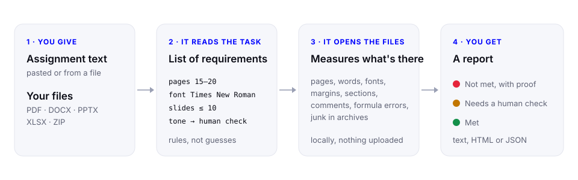
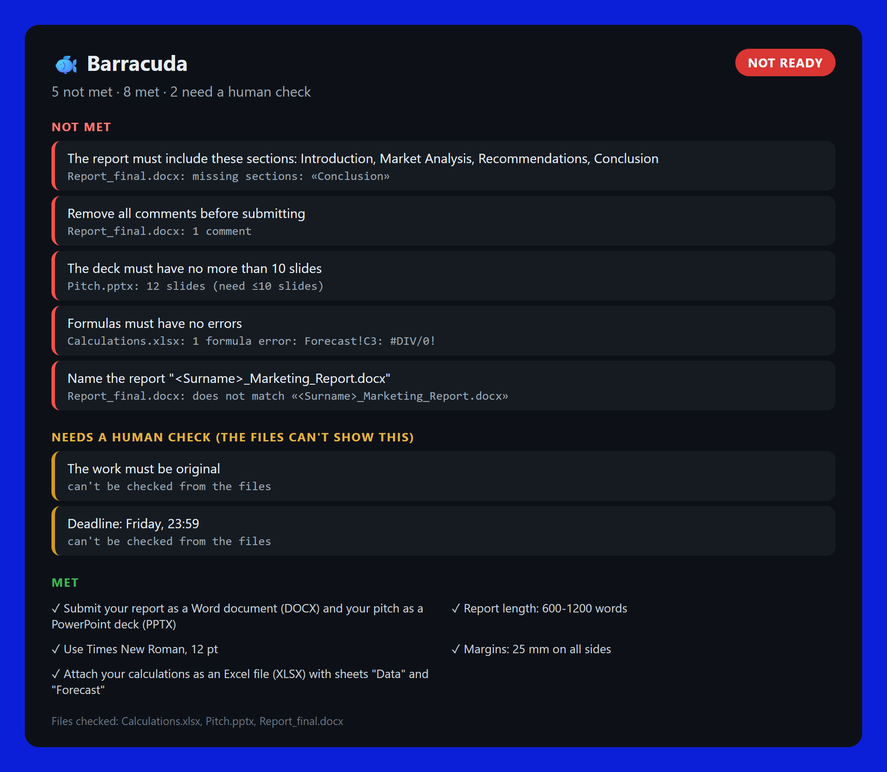
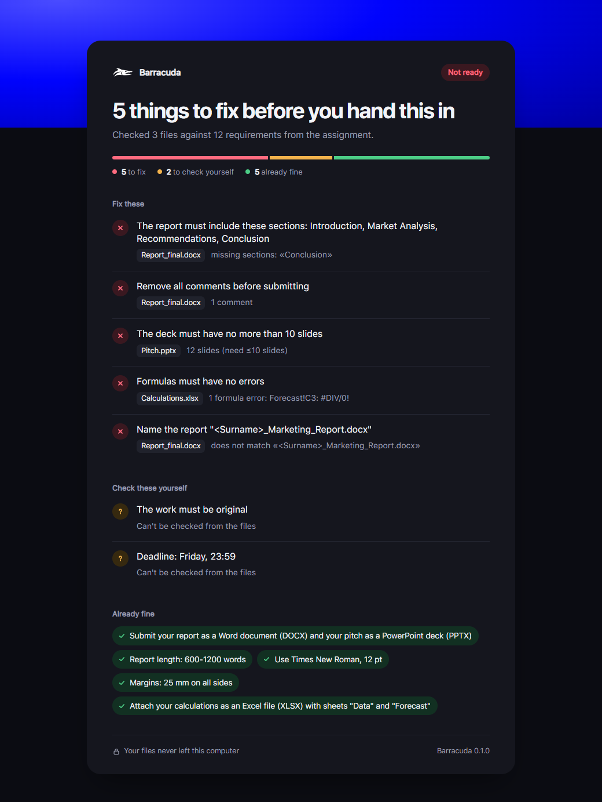
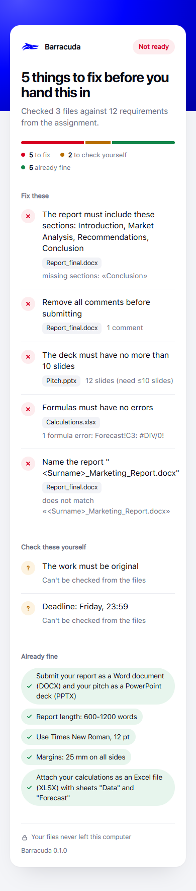
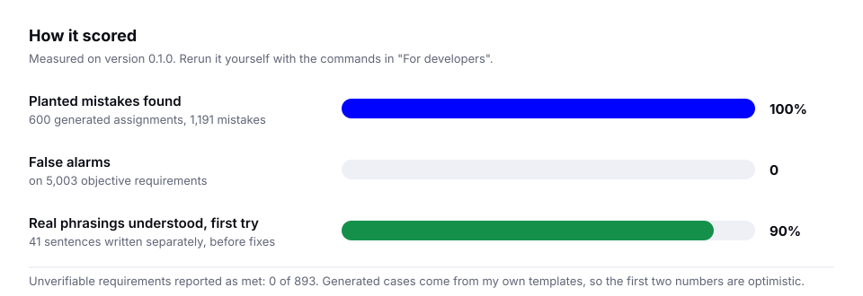

[](https://github.com/Mr-Hames/barracuda/actions/workflows/tests.yml) [](https://github.com/Mr-Hames/barracuda/actions/workflows/codeql.yml) [](https://github.com/Mr-Hames/barracuda/releases) [](LICENSE) [](https://www.bestpractices.dev/projects/16182)

# Barracuda

You finished the work. Before you send it, Barracuda reads the assignment, opens your files and tells you what's missing.

It's a skill for AI coding agents (Claude, Codex, Cursor, GitHub Copilot, Google Antigravity). You give it the task text and your files. It gives you back a short report in three parts: what doesn't meet the requirements, what it can't judge and you need to check yourself, and what's fine.

It works with PDF, Word (DOCX), PowerPoint (PPTX), Excel (XLSX) and ZIP archives, including files packed inside an archive. Assignments can be written in English, Ukrainian or Russian.



## What you can ask

| You write | What it reads from the assignment | What you get |
|---|---|---|
| `Check my coursework against this task` + task.txt, thesis.docx | 15 to 20 pages, Times New Roman 14, left margin 30 mm, sections | Each mismatch with the number it found, e.g. "13 pages (need ≥15)" |
| `Is this ready to send to the client?` + brief from an email, deck.pptx, offer.pdf | PDF only, at most 10 slides, file name pattern, no comments | Wrong format, extra slides, a forgotten reviewer comment |
| `Перевір архів перед здачею` + ZIP with the project | Required files, size limit, no junk | `__MACOSX`, `.DS_Store`, a missing file inside the archive |
| `Проверь таблицу по заданию` + calc.xlsx | Required sheet names, no formula errors | `#DIV/0!` with the exact sheet and cell |
| `Is the essay original and well argued?` | Nothing objective to measure | An honest "needs a human check", never a fake "met" |

## Who it's for

Students handing in coursework, where a lecturer asked for 15 to 20 pages in Times New Roman 14 with 3 cm left margin. Freelancers and agencies sending deliverables to a client who wrote the requirements in an email. Anyone who has had work bounced back because of a wrong file name, a forgotten comment or a missing section.

## What it checks

Barracuda only checks things that can be measured in the file itself. In plain words, it will notice if:

- the file is in the wrong format, has the wrong name or is too big
- there are too few or too many pages, slides or words
- a required section or phrase is missing ("Introduction", "Conclusion", your variant number)
- the font, font size, margins, paper size or orientation are not what was asked
- there are fewer pictures or charts than required
- comments, tracked changes or placeholder text like "Lorem ipsum" were left in
- the Excel file lacks a required sheet or has formula errors like #REF! or #DIV/0!
- the archive contains junk such as __MACOSX or .DS_Store

## What it won't pretend to check

Some requirements can't be judged by looking at the file: originality, tone, quality of arguments, deadlines, number of sources, citation style, line spacing. Barracuda never marks these as done. It lists them under "needs a human check" so nothing quietly slips through.

This is the main rule of the project. If the tool isn't sure, it says so.

## What a report looks like

Here is Barracuda checking a marketing assignment with a Word report, a PowerPoint pitch and an Excel sheet. Five mistakes were hidden in the files, and it found all five. This is the real page it produces (`--format html`), not a mock-up. It follows your system's light or dark theme and works on a phone.



<table><tr>
<td width="68%"></td>
<td width="32%"></td>
</tr><tr><td align="center">Dark mode</td><td align="center">On a phone</td></tr></table>

## Try it in a minute

The repository has that example ready to run, so you don't need your own files to see how it works:

```bash
python scripts/guard.py --task examples/assignment.txt examples/submission/*
```

Or open `examples/assignment.txt` and the files in `examples/submission/`, then ask your agent "check these files against this assignment".

The report comes out in the language of the assignment.

## Install

You need Python 3.9 or newer and a few libraries. Install them once:

```bash
pip install pdfplumber python-docx python-pptx openpyxl defusedxml
```

Then add the skill to your agent. The simplest way picks the right folder by itself:

```bash
npx skills add Mr-Hames/barracuda
```

If you'd rather do it by hand, clone the repository into your agent's skills folder:

| Agent | Folder |
|---|---|
| Claude Code | `~/.claude/skills/barracuda` |
| Codex | `~/.codex/skills/barracuda` |
| Google Antigravity | `~/.gemini/antigravity/skills/barracuda` |
| Cursor | `~/.cursor/skills/barracuda` |
| GitHub Copilot | `~/.copilot/skills/barracuda` |

```bash
git clone https://github.com/Mr-Hames/barracuda ~/.claude/skills/barracuda
```

On claude.ai, download this repository as a ZIP and upload it in Settings, Capabilities, Skills.

Agents sometimes move their skills folder between versions. If yours doesn't see the skill, look up "skills" in its documentation. To make sure everything works, run `python scripts/guard.py --selftest`. It should answer `"selftest": "ok"`.

## How to use it

Attach your files, paste the assignment and ask something like "check my work against this task". That's it.

You can also run the checker yourself, without an agent:

```bash
python scripts/guard.py --task task.txt report.docx slides.pptx
```

That prints the report as text. For the page shown above, add `--format html --out report.html` and open the file in your browser. Add `--format json` to see every detail the script read from your files.

Your files never leave your computer. Everything is read locally, and hostile files (zip bombs, tricky archive paths, broken documents) are handled safely. See [SECURITY.md](SECURITY.md).

## How well it works

This is a prototype, and here are the numbers as they are.



On 600 generated assignments with 1,191 deliberately planted mistakes, Barracuda found all of them, raised no false alarms and never called any of the 893 unverifiable requirements "done". Those assignments come from templates I wrote myself, so the score is optimistic about understanding real wording.

The more honest number comes from 41 real-life phrasings written separately: 90% were understood correctly on the first try, before I fixed anything. The misses never turned into a false "done". In the worst case the tool raised an extra warning or left a requirement for you to check. Those misses are fixed now and the phrasings run as tests, so they can't come back.

To reproduce the big run: `python bench/generate.py --n 600 --seed 7 --out /tmp/b600 && python bench/evaluate.py --cases /tmp/b600`. CI runs a 50-case version on every commit.

Known limits. A Word file's page count is only known if the file was last saved in Microsoft Word. Margins are read from Word files only. Scanned PDFs can't be checked for text. Formatting standards such as APA or DSTU are not built in yet.

## For developers

The checks are done by a script, so the result is the same no matter which AI model runs it. The model only shows the report.

```bash
python scripts/guard.py --task task.txt --extract-only > contract.json   # see how the task was read
python scripts/guard.py --contract contract.json report.docx             # check against an edited list
python -m unittest discover tests                                         # unit and stress tests (see CONTRIBUTING.md)
python bench/generate.py --n 50 --seed 7 && python bench/evaluate.py      # benchmark (needs pymupdf, pillow)
python tests/hard_phrasings_2.py                                          # real-life phrasings
```

Tested on Python 3.9 to 3.13.

## License

MIT
