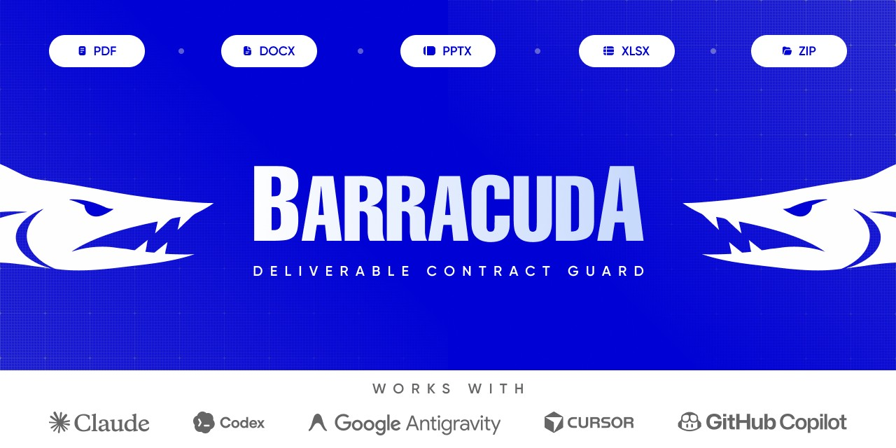

# Barracuda — Deliverable Contract Guard (prototype)

A Claude skill that checks submitted files against a plain-text assignment: it turns the task text (Russian, Ukrainian or English) into a list of requirements, checks the objective ones in the actual PDF / DOCX / PPTX / XLSX / ZIP files, and lists everything it could not verify instead of calling it done.

Checks: required formats, allowed formats only, file name pattern, file size, pages, slides, word count, required sections, required phrases, main font, font size, margins, page size and orientation, number of images, leftover comments, tracked changes, placeholder text, sheet names, formula errors, junk files in archives.

## Status: prototype, go/no-go benchmark

Criterion to continue: on 50 prepared assignments with file sets, detect ≥ 90% of labelled objective violations and never report an unverifiable requirement as met.

| benchmark | cases | planted violations | detected | unverifiable reported as met | false alarms |
|---|---|---|---|---|---|
| seed 7 | 50 | 94 | 100% | 0 of 71 | 0 of 338 |
| seed 2026 | 50 | 96 | 100% | 0 of 75 | 0 of 321 |

**Read these numbers with care.** The benchmark is synthetic: assignments are generated from phrase templates written by the same author as the parser, so it measures the checker and the file readers well and the understanding of real-world wording optimistically. `tests/test_extract.py` adds 15 phrasings that are not in the generator (13 passed on the first try; the 2 failures were fixed). The honest next step is 50 real assignments with real student or client files, labelled by hand.

Known limits: DOCX page count is only known if Word saved it; margins only from DOCX; fonts from PPTX/XLSX are not read; line spacing, character counts, citation styles, originality, tone and deadlines are always "unverified"; requirements written as number words ("five pages") are not parsed.

## Install

The skill is a `SKILL.md` plus a Python script (Python 3.9+), so it works in any agent that supports Agent Skills and can run terminal commands. Install the libraries once:

```bash
pip install pdfplumber python-docx python-pptx openpyxl
```

Then put this repository into your agent's skills folder. The easiest way (picks the right folder for each agent):

```bash
npx skills add Mr-Hames/barracuda
```

Or clone it by hand:

| Agent | Folder (user-wide) |
|---|---|
| Claude Code | `~/.claude/skills/barracuda` |
| Codex | `~/.codex/skills/barracuda` (or `.agents/skills/` in a project) |
| Google Antigravity | `~/.gemini/antigravity/skills/barracuda` |
| Cursor | `~/.cursor/skills/barracuda` (or `.cursor/skills/` in a project) |
| GitHub Copilot | `~/.copilot/skills/barracuda` (or `.github/skills/` in a project) |

```bash
git clone https://github.com/Mr-Hames/barracuda <folder from the table>
```

Claude.ai: download the repo as ZIP and upload it in Settings → Capabilities → Skills.

Folder names change between agent versions; if the agent doesn't see the skill, check its documentation for "skills". To check the installation: `python scripts/guard.py --selftest`.

## Use

Ask the agent: "check my files against this assignment" and attach the files and the task text. Or run it directly:

```bash
python scripts/guard.py --task task.txt report.docx slides.pptx archive.zip       # Markdown report
python scripts/guard.py --task task.txt --format json report.docx                  # full JSON
python scripts/guard.py --task task.txt --extract-only > contract.json             # review, edit, then:
python scripts/guard.py --contract contract.json report.docx
```

The report comes in the assignment's language (English, Russian, Ukrainian). The script does all the checking, so results don't depend on which model runs it; the model only shows the report. Hand-edited contracts are validated: an item with missing or non-numeric values becomes "needs a human check", never "met".

Tested on Python 3.9, 3.10, 3.11, 3.12 and 3.13 (Windows).

## Benchmark

```bash
pip install pymupdf pillow                     # only for generating test files
python bench/generate.py --n 50 --seed 7       # writes bench/cases/ (not in git)
python bench/evaluate.py                       # recall, false passes, false alarms
python -m unittest discover tests
```

PDF generation uses Windows fonts (Times New Roman, Arial, Calibri).
